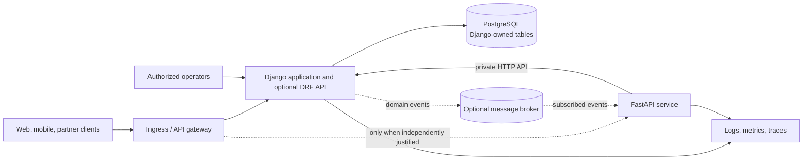
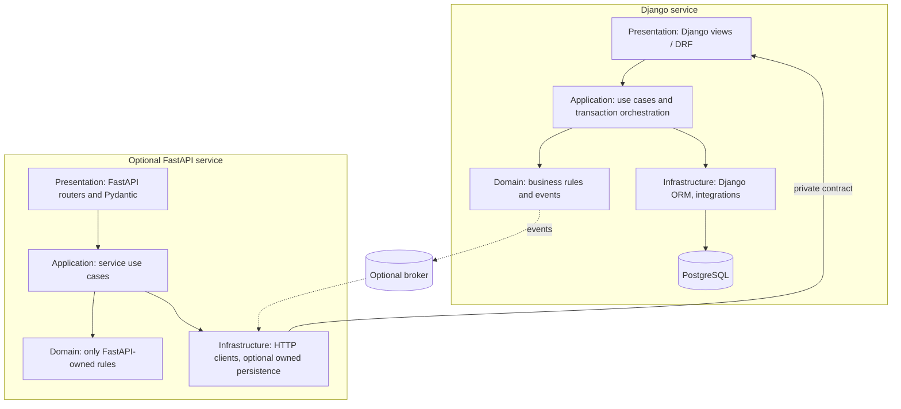

# Architecture proposal

## Status and scope

This is a proposal, not an implemented or approved system design. The repository currently has no application code, business domain, dependency declarations, deployment configuration, or tests. The requirements do not identify the product, its users, data, workflows, integrations, or workload. Those decisions are therefore open; this document does not claim that any listed capability exists.

The immediate recommendation is to establish one authoritative business application and add a second framework only when a confirmed use case justifies its independent runtime. In particular, do not create duplicate domain models or let two applications write the same business tables.

## 1. Business requirements and discovery

### Known objectives

- Provide a maintainable, secure API platform that can be operated in production.
- Support business administration and high-performance or asynchronous API use cases when required.
- Make architecture, security, integration, and deployment decisions explicit and testable.

These are platform objectives, not a definition of the product's business behavior.

### Requirements to confirm

Before creating domain models, endpoints, or migrations, the product owner should answer:

1. What business problem and user outcomes does this API serve?
2. Which clients and external systems will call it, and which interfaces must they use?
3. What user roles, identity provider, authentication flows, and authorization rules are required?
4. What are the core entities, their ownership, relationships, lifecycle, retention, and audit needs?
5. Which workflows, invariants, and transactional boundaries must the system enforce?
6. Are Django Admin, Django-managed workflows, asynchronous endpoints, webhooks, real-time communication, or AI/ML integrations actual launch requirements?
7. Which integrations and message delivery guarantees are required?
8. What are the expected traffic, latency, availability, recovery, and data residency targets?
9. Which deployment environment and operational services (PostgreSQL, Redis, broker, observability platform) are selected?
10. What regulatory, privacy, threat-model, and audit requirements apply?

### Provisional assumptions

- PostgreSQL is the default relational store, pending confirmation of hosting and operational constraints.
- HTTP APIs are the initial interface; no specific resource names or business operations are assumed.
- Authentication, availability, throughput, and retention targets are not yet specified and must be agreed before production acceptance.
- Redis, Celery, a message broker, Kubernetes, cloud-specific services, and a second application are optional—not baseline dependencies.

## 2. Recommended architecture and technology choices

Start with a Django application as the system of record if the confirmed product needs business workflows, administration, or Django-managed data. Use Django ORM and Django Admin for that domain; add DRF only for Django-owned resources that need its serializers, viewsets, or permission integration.

Add a separately deployable FastAPI service only when a distinct workload benefits from it—for example, independently scaled asynchronous integrations or latency-sensitive endpoints. FastAPI should call Django through a private, versioned service API for Django-owned business operations and publish/consume explicit events for asynchronous collaboration. It must not import Django models or directly modify Django-owned tables.

If discovery shows that the product is an API-only service with no meaningful Django administration or workflow needs, prefer FastAPI alone. Do not select both frameworks just because both appear in the platform prompt.

| Technology | Proposed use | Decision |
| --- | --- | --- |
| Python 3.12+ | Runtime | Confirm supported hosting and dependency compatibility before pinning. |
| Django | Business system of record and administration, if required | Recommended starting point when business workflows/Admin are needed. |
| DRF | HTTP APIs for Django-owned resources | Use selectively; avoid a second API abstraction without need. |
| FastAPI | Independent async/integration service | Conditional on a separate workload and service boundary. |
| PostgreSQL | Relational persistence | Default; Django owns its tables and migrations. |
| SQLAlchemy | Persistence for a distinct FastAPI-owned domain, if one exists | Do not map the same domain entities in both ORMs. |
| Pydantic | FastAPI request/response and settings models | Use at the FastAPI boundary. |
| Redis / Celery | Cache and background task execution | Add only after workload, delivery, and failure semantics are known. |
| Docker / Kubernetes | Packaging / orchestration | Containerize after runtime and deployment requirements are selected; Kubernetes is not assumed. |
| Pytest / HTTPX | Test framework and API client | Adopt with the project implementation; no test setup currently exists. |

### System context



The gateway, broker, and observability backend are logical boundaries, not selected products. A single Django deployment may be sufficient for the first release.

### Component architecture



Keep framework and ORM dependencies at presentation/infrastructure edges. Application use cases coordinate work; domain rules should not depend on Django, FastAPI, or persistence implementations. Establish shared contracts only for stable service and event schemas, not shared ORM models.

## 3. Integration and database strategy

Use Django as the sole owner of its business tables, schema changes, and migrations. FastAPI accesses Django-owned data through the internal API or consumes events for read/async needs. This avoids shared-table writes, conflicting migrations, and duplicated business invariants.

| Option | Assessment |
| --- | --- |
| Shared PostgreSQL tables written by both applications | Reject by default: creates competing ownership, ORM mappings, transaction semantics, and migration authority. |
| Django exposed as an internal service | Preferred synchronous boundary for Django-owned business commands and queries. Define authentication, timeouts, versioning, and failure behavior. |
| Independently deployed applications | Use only for a confirmed independent scaling, availability, or technology boundary. Separate deployment does not imply shared database ownership. |
| Event-driven communication | Optional for decoupling and asynchronous work. Define event ownership, schema evolution, delivery guarantees, idempotency, retries, and dead-letter handling before adopting. |

If FastAPI later owns a genuinely distinct data domain, give it distinct tables/schema, an explicit owner, and an independently managed migration process. Cross-domain operations must use service contracts or events, not cross-owner writes. PostgreSQL transactions do not span HTTP services; use a documented saga/compensation strategy if a business workflow truly crosses service boundaries.

## 4. API design

Once resources and workflows are confirmed:

- Publish versioned, resource-oriented endpoints under `/api/v1`; use the correct HTTP method and status code for each operation.
- Validate requests and responses at the boundary (Pydantic for FastAPI; DRF serializers where DRF is selected).
- Define consistent error envelopes, stable machine-readable error codes, and field-level validation details without leaking internals.
- Specify bounded pagination, allowlisted sorting/filtering/search, and limits before exposing collection endpoints.
- Use idempotency keys for operations where client retries could duplicate business effects.
- Propagate a validated correlation/trace identifier across gateway, services, tasks, and logs.
- Generate OpenAPI for FastAPI and document any Django/DRF API alongside it; define compatibility and deprecation policy.
- Implement health, liveness, readiness, and metrics endpoints only with non-sensitive responses and appropriate network access.

No example business resource or endpoint is prescribed until the domain is known.

## 5. Security architecture

Treat these controls as design requirements to implement and verify, not existing features:

- Select an OAuth 2.0 / OpenID Connect provider and flows after identifying client types. Validate JWT signature, issuer, audience, expiry, and key rotation; define refresh-token handling with the identity provider.
- Enforce least-privilege, server-side authorization at each operation and object boundary. Define roles and permissions from actual workflows.
- Use framework password hashing if local credentials are approved; do not design a custom password or token scheme.
- Restrict CORS to known browser origins; use CSRF protections for cookie-authenticated browser flows.
- Apply input validation, parameterized ORM/database access, request size/time limits, and rate limits at an appropriate gateway/application boundary.
- Store secrets in the selected deployment secret manager or injected environment; never commit credentials or use example values as production secrets.
- Use TLS in transit, secure headers, restricted service-to-service credentials, and redacted structured audit/security logs.
- Define threat model, data classification, retention, incident response, and security testing before production release.

## 6. Reliability, performance, and observability

Establish measurable service-level objectives before tuning or claiming capacity. Apply bounded database connection pools, query review/indexes, request and dependency timeouts, and bounded pagination. Keep API instances stateless where practical.

Use async I/O only for genuinely concurrent I/O workloads. Add Redis caching only with explicit ownership, TTL, invalidation, and privacy rules. Add Celery or another worker/broker only after task durability, retry limits, idempotency, poison-message handling, and operational ownership are specified. External calls need timeouts and bounded retries; circuit breakers are justified by measured dependency behavior.

Instrument structured logs, metrics, and distributed traces using agreed conventions (OpenTelemetry is a candidate). Include correlation identifiers and redact tokens, credentials, and sensitive payloads. Separate liveness from readiness; readiness may test critical dependencies without revealing details publicly.

## 7. Testing strategy

The eventual test suite should cover:

- Unit tests for domain rules and application use cases.
- Integration tests for ORM mappings, migrations, database transactions, and selected infrastructure adapters.
- API tests for validation, expected status/error contracts, authentication, authorization, idempotency, and rate limits.
- Contract tests for private service APIs and versioned events.
- Failure-path tests for dependency timeouts, retries, duplicate delivery, and unavailable infrastructure where applicable.
- Load/performance tests tied to agreed traffic and latency objectives.

Use isolated test settings and safe test credentials/data. Set a meaningful coverage target based on critical behavior rather than treating a raw percentage as proof of quality. There is currently no test configuration or test code in this repository.

## 8. Deployment and operations

After selecting the deployment target, prepare non-root, minimal container images, health probes, environment-based settings, migration/runbook procedures, and a CI pipeline that runs formatting/lint, type checks, tests, dependency/security checks, and image validation. Keep schema migrations an explicit, serialized release step owned by Django. Do not run independent services' migrations against tables they do not own.

Kubernetes manifests, Docker Compose, cloud-specific services, and CI/CD provider configuration should follow confirmed operational needs; none are present or selected today. Define backup/restore, rollback, secrets rotation, capacity, and disaster-recovery procedures before production use.

## 9. Proposed repository structure

Adapt this structure after requirements and framework boundaries are approved; do not create empty scaffolding preemptively.

```text
apps/
  django_service/
    config/
    domain_apps/
    api/
  fastapi_service/        # only if justified
    api/v1/
    application/
    domain/
    infrastructure/
shared/
  contracts/              # versioned service/event contracts only
tests/
  unit/
  integration/
  api/
infrastructure/
  docker/                 # after container requirements are selected
  kubernetes/              # only if Kubernetes is selected
docs/
  architecture.md
  adr/
```

## 10. Decision log, risks, and roadmap

### Provisional architecture decisions

1. Do not assume both frameworks are needed; choose the smallest architecture that meets confirmed use cases.
2. When Django is present, it owns Django-managed business data and migrations.
3. FastAPI, if added, is an independent service with an API/event boundary and no direct writes to Django-owned tables.
4. PostgreSQL is the provisional relational database; cache, broker, worker, and orchestrator choices remain open.

Record approved decisions as dated ADRs once stakeholders confirm the relevant context and consequences.

### Main risks and trade-offs

- **Unknown business scope:** premature models and endpoints could encode incorrect workflows. Mitigation: complete discovery before implementation.
- **Two-framework operational cost:** separate runtimes, deployment, observability, contracts, and on-call burden. Mitigation: add FastAPI only for demonstrated need.
- **Cross-service consistency:** HTTP and event workflows cannot rely on one database transaction. Mitigation: keep early workflows within one owner; document idempotency and compensation where distribution is necessary.
- **Overbuilt infrastructure:** Redis, Celery, Kubernetes, and multi-cloud support add operational complexity. Mitigation: select only against explicit requirements.
- **Unspecified security and SLOs:** controls cannot be validated without identity, threat, data, availability, and latency targets. Mitigation: obtain these before production acceptance.

### Implementation roadmap

1. **Discovery:** answer the questions above; approve domain, actors, workflows, data classification, integrations, and SLOs.
2. **Architecture:** choose one or both frameworks, ownership boundaries, API contracts, identity approach, deployment target, and record ADRs/diagrams.
3. **Foundation:** scaffold only the approved application(s); add configuration, logging, security, database connectivity, migrations, and local development setup.
4. **Implementation:** build one vertical business capability at a time with validation and explicit ownership.
5. **Testing and hardening:** add unit, integration, API, security, and workload tests; resolve identified defects.
6. **Deployment:** add selected container/orchestration and CI/CD configuration, migration/runbook process, and operational documentation.

No production code should be generated until phases 1 and 2 have been reviewed and the open decisions that affect the implementation are resolved.
